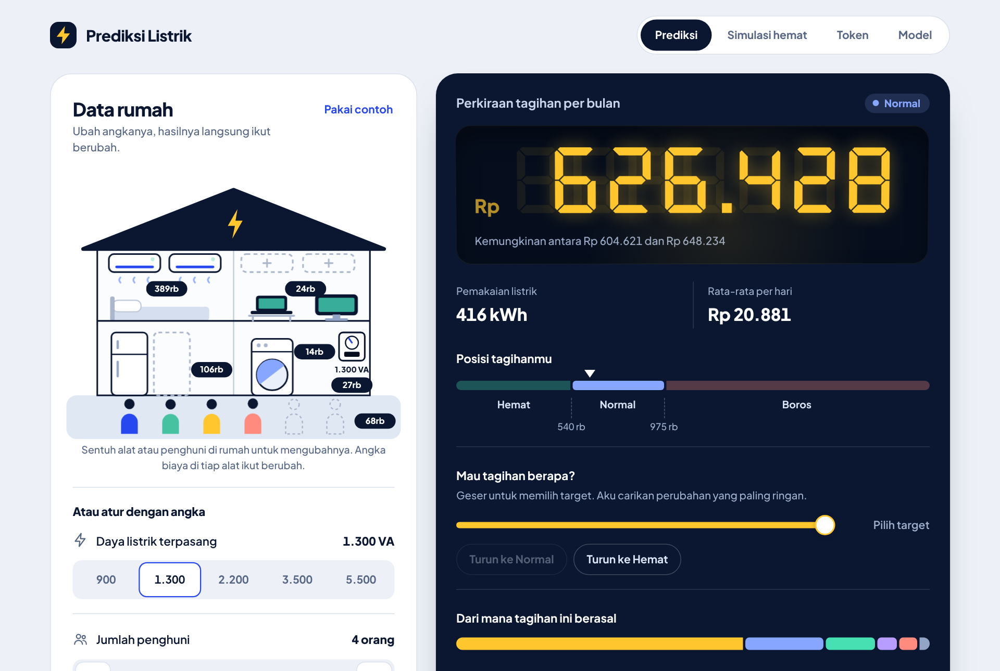
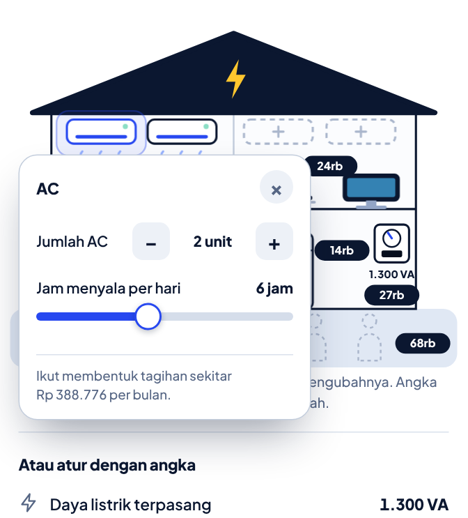
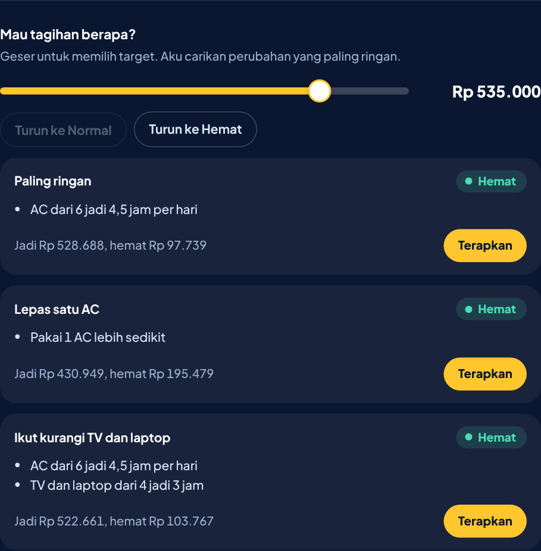
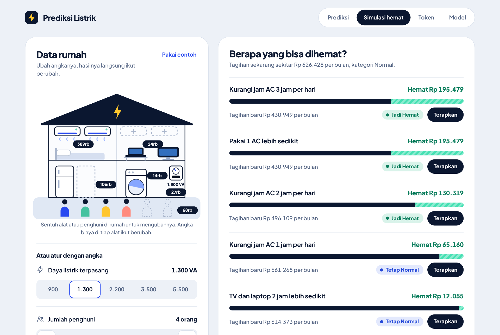
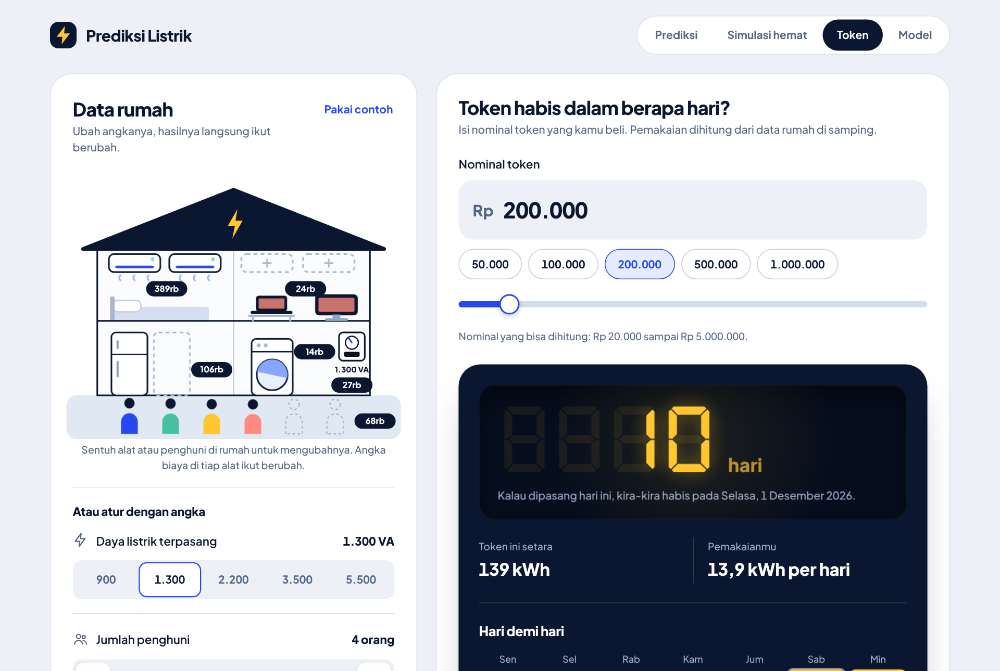
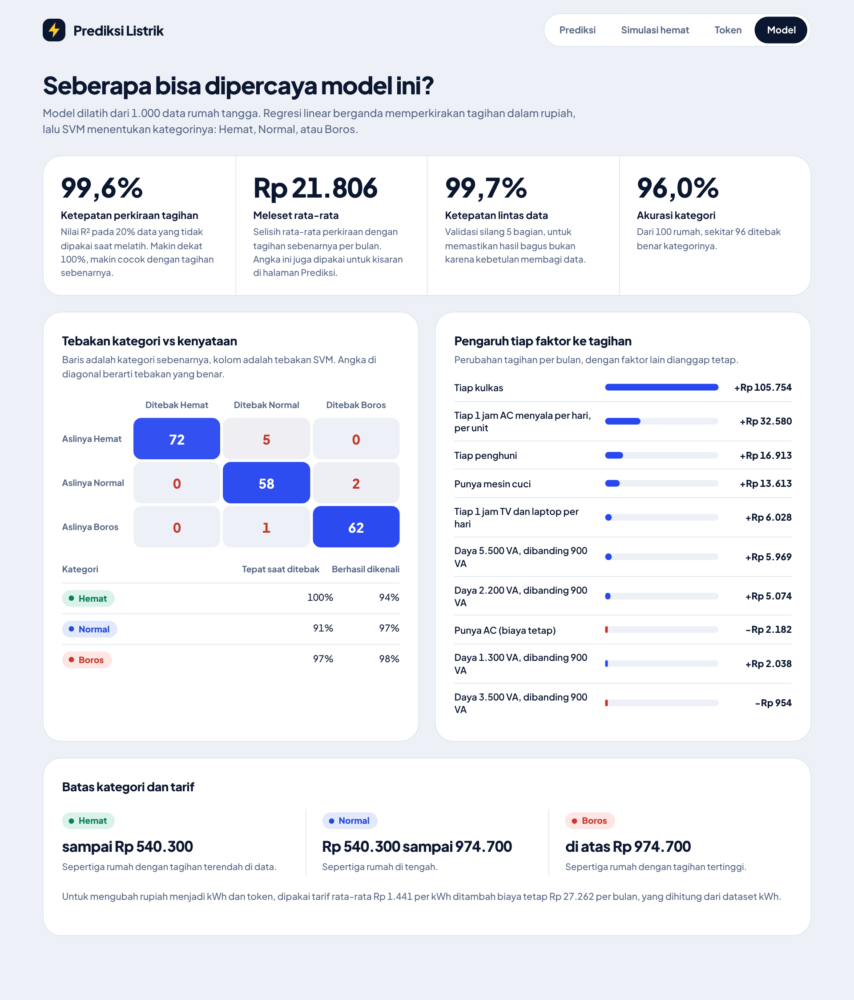
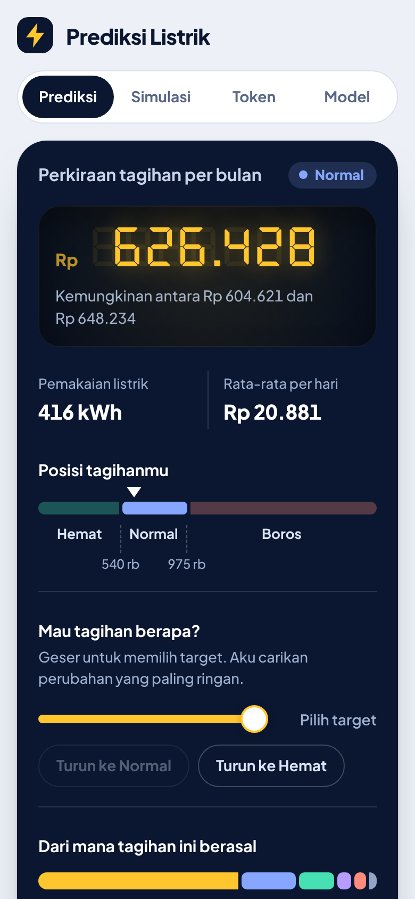
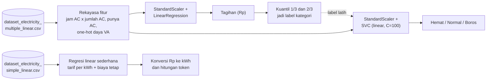
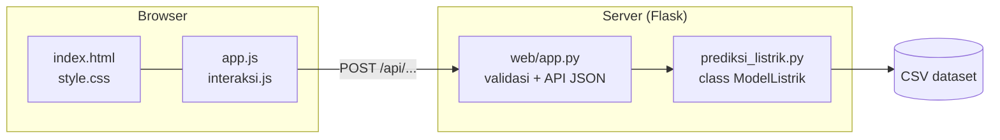

<div align="center">

# ⚡ Prediksi Tagihan Listrik

**Perkirakan tagihan listrik rumah tangga dari kebiasaan memakai alat elektronik, lihat berapa yang bisa dihemat, dan cari tahu token habis dalam berapa hari.**




</div>

## Daftar isi

- [Fitur](#fitur)
- [Tampilan](#tampilan)
- [Mulai cepat](#mulai-cepat)
- [Cara pakai](#cara-pakai)
- [Cara kerja model](#cara-kerja-model)
- [Arsitektur aplikasi web](#arsitektur-aplikasi-web)
- [Referensi API](#referensi-api)
- [Struktur proyek](#struktur-proyek)
- [Pemecahan masalah](#pemecahan-masalah)
- [Batasan](#batasan)
- [Konteks proyek](#konteks-proyek)

## Fitur

| | |
| --- | --- |
| **Perkiraan tagihan** | Tagihan per bulan dalam rupiah, lengkap dengan kisaran kemungkinan, pemakaian kWh, dan rincian biaya per komponen. |
| **Kategori** | Hemat, Normal, atau Boros, ditentukan oleh model SVM. |
| **Simulasi hemat** | Bandingkan skenario seperti "kurangi AC 2 jam" atau "pakai 1 AC lebih sedikit", lalu terapkan dengan satu klik. |
| **Target tagihan** | Tentukan target, dan aplikasi mencari perubahan paling ringan untuk mencapainya. |
| **Token listrik** | Hitung token yang dibeli akan bertahan berapa hari, beserta perkiraan tanggal habis. |
| **Rumah interaktif** | Ilustrasi rumah yang bisa disentuh. Ubah AC, TV, kulkas, mesin cuci, daya VA, dan jumlah penghuni langsung dari gambarnya. |
| **Transparan** | Halaman Model menampilkan akurasi, matriks kebingungan, dan pengaruh tiap faktor, tanpa menyembunyikan kelemahan model. |

Selain tampilan web, project ini punya aplikasi terminal dengan menu yang sama.

## Tampilan

<table>
  <tr>
    <td width="50%"><br><sub><b>Rumah interaktif.</b> Sentuh alat untuk mengubahnya, biaya per bulan tampil di tiap alat.</sub></td>
    <td width="50%"><br><sub><b>Target tagihan.</b> Tiga saran dengan gaya berbeda, bisa langsung diterapkan.</sub></td>
  </tr>
  <tr>
    <td><br><sub><b>Simulasi hemat.</b> Skenario otomatis plus skenario buatan sendiri.</sub></td>
    <td><br><sub><b>Token.</b> Kalender hari demi hari sampai token habis.</sub></td>
  </tr>
</table>

<details>
<summary><b>Halaman Model dan tampilan HP</b></summary>
<br>





</details>

## Mulai cepat

### Prasyarat

- Python 3 (dikembangkan dan diuji dengan Python 3.13)
- `pip`

### Pasang

```bash
git clone https://github.com/Bim-git-hub/PrekdisiListrik.git
cd PrekdisiListrik

python -m venv .venv
```

Aktifkan environment:

```powershell
# Windows (PowerShell)
.venv\Scripts\Activate.ps1
```

```bash
# macOS / Linux
source .venv/bin/activate
```

Pasang dependensi:

```bash
pip install -r requirments.txt        # pandas, scikit-learn, dan kawan-kawan
pip install -r web/requirements.txt   # Flask, hanya untuk tampilan web
```

> Nama berkas `requirments.txt` memang ditulis begitu di repo ini. Kalau pemasangan dari berkas itu gagal, pasang langsung dengan
> `pip install pandas scikit-learn flask`.

### Jalankan

**Tampilan web**

```bash
python web/app.py
```

Buka http://127.0.0.1:5000. Model dilatih sekali saat server mulai, jadi tunggu pesan `Model siap` di terminal.

**Aplikasi terminal**

```bash
python prediksi_listrik.py
```

## Cara pakai

### Tampilan web

| Tab | Gunanya |
| --- | --- |
| **Prediksi** | Isi data rumah, lihat tagihan, kategori, rincian, dan atur target tagihan. |
| **Simulasi hemat** | Lihat skenario hemat otomatis atau buat skenario sendiri, lalu terapkan. |
| **Token** | Isi nominal token, lihat berapa hari token bertahan. |
| **Model** | Periksa seberapa bisa dipercaya model ini. |

Tips penggunaan:

- Data rumah bisa diubah dari **gambar rumah** atau dari **kolom angka** di bawahnya. Keduanya saling sinkron.
- Arahkan kursor ke baris **rincian tagihan** untuk menyorot alatnya di rumah. Klik untuk membuka pengaturannya.
- Setiap perubahan dari **Terapkan** bisa diurungkan lewat tombol di notifikasi bawah layar.
- Data rumah terakhir tersimpan di browser (localStorage), jadi tidak hilang saat halaman dimuat ulang.
- Semua bisa dipakai dengan keyboard. Panah kiri dan kanan memindah tab, `Enter` atau `Spasi` membuka alat di rumah, dan `Esc` menutup popover.
- Animasi mengikuti pengaturan sistem `prefers-reduced-motion`.

### Aplikasi terminal

```text
========================================================
  PREDIKSI TAGIHAN LISTRIK RUMAH TANGGA
========================================================
  1. Perkirakan tagihan listrik bulan ini
  2. Simulasi: berapa yang bisa dihemat?
  3. Token saya habis dalam berapa hari?
  0. Keluar
```

Opsi baris perintah: `python prediksi_listrik.py --data <folder>` jika berkas CSV berada di folder lain.

## Cara kerja model



### Data

Dua dataset, masing-masing 1.000 baris.

**`dataset_electricity_multiple_linear.csv`** dipakai untuk model utama.

| Kolom | Arti |
| --- | --- |
| `electric_power_va` | Daya terpasang (900, 1300, 2200, 3500, 5500 VA) |
| `num_occupants` | Jumlah penghuni |
| `num_ac_units` | Jumlah AC |
| `ac_hours_per_day` | Jam AC menyala per hari, per unit |
| `num_refrigerators` | Jumlah kulkas |
| `tv_laptop_hours_per_day` | Jam TV dan laptop menyala per hari |
| `has_washing_machine` | Punya mesin cuci (0 atau 1) |
| `electricity_bill_idr` | **Target.** Tagihan bulanan dalam rupiah |

**`dataset_electricity_simple_linear.csv`** berisi `total_kwh_monthly` dan `electricity_bill_idr`. Dari sini dihitung tarif rata-rata dan biaya tetap untuk mengubah rupiah menjadi kWh.

### Model

| Tugas | Metode | Catatan |
| --- | --- | --- |
| Memperkirakan tagihan | `StandardScaler` + `LinearRegression` | Data dibagi 80/20 (`random_state=42`), divalidasi silang 5 bagian |
| Menentukan kategori | `StandardScaler` + `SVC(kernel="linear", C=100)` | Label dari kuantil 1/3 dan 2/3 tagihan |
| Rupiah ke kWh | Regresi linear sederhana | Tarif sekitar Rp 1.441 per kWh dan biaya tetap sekitar Rp 27.262 per bulan |

### Hasil evaluasi

Diukur pada 20% data yang tidak dipakai saat melatih.

| Metrik | Nilai |
| --- | --- |
| R² regresi | **99,6%** |
| R² validasi silang (5 bagian) | **99,7%** |
| Rata-rata meleset (MAE) | **Rp 21.806** per bulan |
| Akurasi kategori SVM | **96,0%** |

Batas kategori yang dihasilkan: **Hemat** sampai Rp 540.300, **Normal** Rp 540.300 sampai Rp 974.700, **Boros** di atas Rp 974.700.

### Dari tagihan ke token

```text
kWh per bulan  = (tagihan - biaya tetap) / tarif per kWh
kWh per hari   = kWh per bulan / 30
kWh token      = nominal token / tarif per kWh
hari bertahan  = kWh token / kWh per hari
```

Contoh: rumah contoh (tagihan sekitar Rp 626.428) dengan token Rp 200.000 bertahan sekitar **10 hari**.

## Arsitektur aplikasi web

Logika prediksi **tidak ditulis ulang**. `web/app.py` mengimpor class `ModelListrik` dari `prediksi_listrik.py` apa adanya, jadi hasil di web selalu sama dengan versi terminal.



- **Frontend** murni HTML, CSS, dan JavaScript tanpa framework dan tanpa langkah build. Font disimpan lokal di `web/static/fonts`, jadi halaman jalan tanpa internet.
- **Backend** memvalidasi semua input dengan batas yang sama seperti versi terminal, lalu mengembalikan JSON.
- Pencarian **target tagihan** menghitung ribuan kombinasi langsung dari koefisien regresi, lalu hasil akhirnya diverifikasi ulang oleh model asli.

## Referensi API

Semua endpoint `POST` menerima dan mengembalikan JSON.

| Endpoint | Fungsi |
| --- | --- |
| `GET /api/meta` | Kualitas model, koefisien, batas kategori, dan tarif |
| `POST /api/predict` | Tagihan, kategori, kWh, dan rincian |
| `POST /api/simulate` | Skenario hemat beserta parameter untuk diterapkan |
| `POST /api/target` | Perubahan paling ringan untuk mencapai target tagihan |
| `POST /api/token` | Lama token bertahan |

**Bentuk data rumah**

| Kolom | Batas |
| --- | --- |
| `electric_power_va` | 900, 1300, 2200, 3500, atau 5500 |
| `num_occupants` | 1 sampai 6 |
| `num_ac_units` | 0 sampai 4 |
| `ac_hours_per_day` | 0 sampai 14 (diabaikan bila tanpa AC) |
| `num_refrigerators` | 1 sampai 2 |
| `tv_laptop_hours_per_day` | 0 sampai 10 |
| `has_washing_machine` | 0 atau 1 |

<details>
<summary><b>Contoh: <code>POST /api/predict</code></b></summary>

```bash
curl -X POST http://127.0.0.1:5000/api/predict \
  -H "Content-Type: application/json" \
  -d '{
    "electric_power_va": 1300,
    "num_occupants": 4,
    "num_ac_units": 2,
    "ac_hours_per_day": 6,
    "num_refrigerators": 1,
    "tv_laptop_hours_per_day": 4,
    "has_washing_machine": 1
  }'
```

```json
{
  "tagihan": 626428,
  "rendah": 604621,
  "tinggi": 648234,
  "kwh": 415.7,
  "per_hari": 20881,
  "kategori": "Normal",
  "rincian": [
    { "nama": "AC", "nilai": 388776 },
    { "nama": "Kulkas", "nilai": 105754 },
    { "nama": "Jumlah penghuni", "nilai": 67651 },
    { "nama": "Biaya dasar & daya VA", "nilai": 26523 },
    { "nama": "TV / laptop", "nilai": 24110 },
    { "nama": "Mesin cuci", "nilai": 13613 }
  ],
  "tip": { "jenis": "ac", "hemat": 65159.6 }
}
```

Angka di atas dibulatkan agar mudah dibaca.

</details>

<details>
<summary><b>Contoh: <code>POST /api/target</code></b></summary>

Body berisi `rumah` dan `target`:

```json
{ "rumah": { "...": "data rumah seperti di atas" }, "target": 535000 }
```

```json
{
  "sudah": false,
  "bisa": true,
  "opsi": [
    {
      "judul": "Paling ringan",
      "perubahan": ["AC dari 6 jadi 4,5 jam per hari"],
      "tagihan": 528688,
      "hemat": 97739,
      "kategori": "Hemat",
      "param": { "num_ac_units": 2, "ac_hours_per_day": 4.5, "tv_laptop_hours_per_day": 4.0 }
    }
  ]
}
```

Respons asli berisi hingga tiga opsi dengan gaya berbeda: paling ringan, lepas satu AC, dan ikut kurangi TV dan laptop.

</details>

<details>
<summary><b>Contoh: <code>POST /api/token</code> dan respons galat</b></summary>

```json
{ "rumah": { "...": "data rumah" }, "nominal": 200000 }
```

```json
{ "hari": 10.01, "kwh_hari": 13.86, "kwh_token": 138.76, "tarif": 1441.33 }
```

Input yang tidak valid mengembalikan HTTP 400:

```json
{ "error": "Daya listrik harus salah satu dari: 900, 1300, 2200, 3500, 5500" }
```

</details>

## Struktur proyek

```text
PrekdisiListrik/
├── prediksi_listrik.py                       # Model dan aplikasi terminal (versi utama)
├── prediksi_listrik_dev.py                   # Versi pengembangan: menampilkan cara kerja Modul 1 sampai 3
├── PrediksiListrik_pembanding.py             # Versi pembanding satu berkas
├── dataset_electricity_multiple_linear.csv   # Data utama (1.000 baris)
├── dataset_electricity_simple_linear.csv     # Data tarif per kWh (1.000 baris)
├── requirments.txt                           # Dependensi model
├── docs/
│   └── screenshots/                          # Gambar untuk README
└── web/
    ├── app.py                                # Server Flask dan API
    ├── requirements.txt                      # Dependensi tambahan (Flask)
    └── static/
        ├── index.html                        # Halaman
        ├── style.css                         # Gaya
        ├── app.js                            # Form, tab, dan pemanggilan API
        ├── interaksi.js                      # Rumah interaktif, target, kalender token
        └── fonts/                            # Plus Jakarta Sans dan DSEG7 (lokal)
```

## Pemecahan masalah

<details>
<summary><b><code>ModuleNotFoundError: No module named 'pandas'</code></b></summary>

Dependensi belum terpasang di environment yang aktif. Pastikan environment sudah diaktifkan (nama environment tampil di awal baris terminal), lalu:

```bash
pip install -r requirments.txt
pip install -r web/requirements.txt
```

</details>

<details>
<summary><b>Halaman kosong atau tampil tanpa gaya</b></summary>

Folder `static/` harus berada di sebelah `app.py`. Jalankan dari folder project dengan `python web/app.py`, dan jangan memindahkan `app.py` keluar dari folder `web/`.

</details>

<details>
<summary><b>Dataset '...' tidak ditemukan</b></summary>

Berkas CSV tidak ada di folder project. Arahkan ke foldernya:

```bash
python web/app.py --data "C:\path\ke\folder\csv"
```

</details>

<details>
<summary><b>Port 5000 sudah dipakai</b></summary>

```bash
python web/app.py --port 8080
```

</details>

<details>
<summary><b>Ingin membuka dari HP di jaringan yang sama</b></summary>

```bash
python web/app.py --host 0.0.0.0
```

Lalu buka `http://<alamat-ip-komputer>:5000` di HP. Server ini ditujukan untuk pemakaian lokal dan belajar, jangan dibuka ke internet publik.

</details>

## Batasan

- Hasilnya **perkiraan statistik**, bukan jaminan tagihan resmi. Tarif nyata, pajak, dan potongan admin token tidak dihitung.
- Angka evaluasi hanya berlaku untuk data di repo ini. Model belum diuji pada data tagihan nyata dari luar dataset.
- Model memakai fitur yang ada di dataset saja: daya VA, penghuni, AC, kulkas, TV dan laptop, serta mesin cuci. Alat lain seperti water heater atau pompa air tidak ikut dihitung.
- Server web dijalankan dengan server pengembangan bawaan Flask. Itu cukup untuk demo dan belajar, tapi bukan untuk produksi.
- Belum ada tes otomatis. Pemeriksaan dilakukan dengan menjalankan aplikasi dan membandingkan hasil API dengan model terminal.

## Konteks proyek

Dikerjakan sebagai proyek UAS praktikum **Kecerdasan Artifisial**. Materinya mengikuti tiga modul:

| Modul | Materi | Dipakai untuk |
| --- | --- | --- |
| 1 | Teknik labelling data | `LabelEncoder` dan label kategori Hemat/Normal/Boros |
| 2 | Teknik preprocessing data | One-hot daya VA, standarisasi (`StandardScaler`) |
| 3 | Supervised learning | Regresi linear dan klasifikasi SVM |

Untuk melihat tiap modul bekerja langkah demi langkah, jalankan `python prediksi_listrik_dev.py` dan pilih menu **Lihat cara kerja tiap modul**.

---

<div align="center">

Dibuat oleh [Bim-git-hub](https://github.com/Bim-git-hub)

</div>
